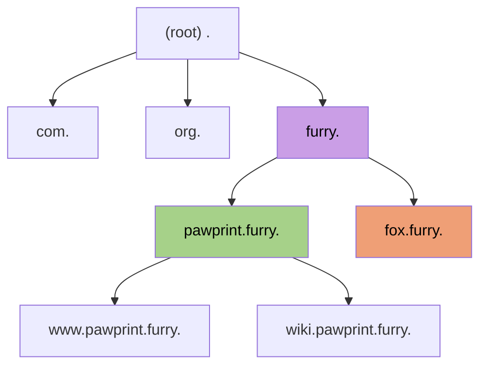
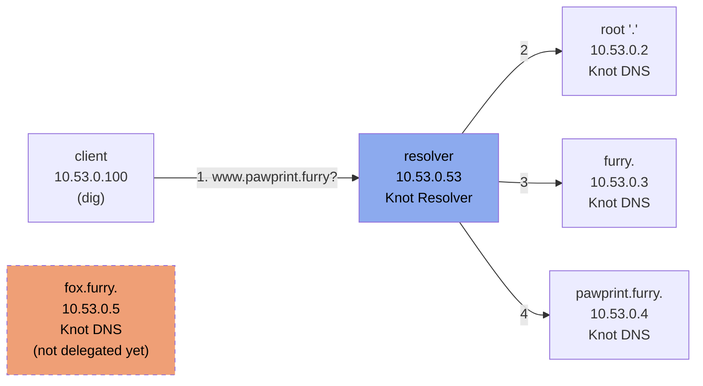
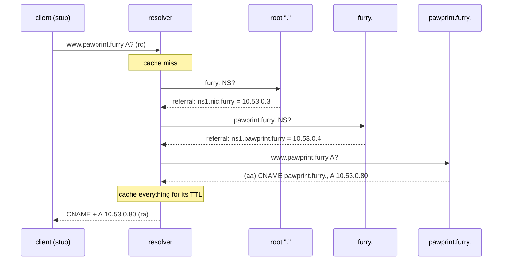

About me
===


Rechner [ˈʀɛçnɐ] (he/him)

* Fox (Very soft)
* Software developer (groan)
  * Dev-ops, specifically
* CTO of Pawprint Prototyping
* Nerd for Telephones

<!-- end_slide -->

What is DNS?
===

The **Domain Name System** turns names people can remember into the
addresses computers actually use.

```
wiki.pawprint.furry  ──►  10.53.0.81
```

<!-- pause -->

* It's a **database**: "name + record type ──► data"
* It's **distributed**: no single server knows every name
* It's **hierarchical**: each part of a name is owned by someone different
* It's **cached**: answers get remembered for a while (the TTL)
* The **phonebook** of the internet: Names are easier to remember than IP addresses

<!-- pause -->

## Why should a maker care?

* Self-hosting a wiki, Home Assistant, even a local service will likely involve DNS
* "It works by IP but not by name" is a common homelab complaint
* "It's always DNS" is a meme because it's true

<!-- end_slide -->

Anatomy of a name
===

Read a domain name **right to left**. Every dot is a step down the tree.

```
www . pawprint . furry . (root)
 │        │        │       └─ the root zone: "."  (usually invisible)
 │        │        └───────── top-level domain (TLD)
 │        └────────────────── second-level domain
 └─────────────────────────── a host name inside pawprint.furry
```

<!-- pause -->

The trailing dot is real. `www.pawprint.furry.` is the
**fully qualified domain name** (FQDN). Zone files and tools like `dig` show it everywhere.

<!-- pause -->



<!-- end_slide -->

Zones and delegation
===

A **zone** is a piece of the tree that one set of nameservers is responsible for.

**Delegation** is a parent zone saying:
> "I don't know about that part of the tree. Go ask *those* nameservers."

<!-- pause -->

| Zone | Run by (real world) | Run by (our lab) |
|------|---------------------|------------------|
| `.` | 13 root server "letters", run by 12 orgs | `a.root-servers.net` 10.53.0.2 |
| `furry.` | a TLD registry | `ns1.nic.furry` 10.53.0.3 |
| `pawprint.furry.` | you, or your DNS host | `ns1.pawprint.furry` 10.53.0.4 |
| `fox.furry.` | someone else entirely | `ns1.fox.furry` 10.53.0.5 |

<!-- pause -->

The root doesn't know where `wiki.pawprint.furry` is.
It only knows who runs `furry.`. That's the whole trick, and it's why DNS scales.

<!-- end_slide -->

The cast of characters
===

<!-- column_layout: [1, 1] -->

<!-- column: 0 -->

## Stub resolver
The tiny DNS client in your laptop, phone, or ESP32.
Asks *one* server and trusts whatever comes back.
Configured in `/etc/resolv.conf`, DHCP, or your router.

## Recursive resolver
Does the legwork. Walks the tree from the root, follows referrals,
and **caches** everything.
Examples: your ISP, `1.1.1.1`, Pi-hole + Unbound, **Knot Resolver**.

<!-- column: 1 -->

## Authoritative server
Holds the real data for a zone and answers only for that zone.
Sets the `aa` ("authoritative answer") flag.
Never goes and asks anyone else.
Examples: BIND, NSD, PowerDNS, **Knot DNS**.

## Registrar / registry
Where the parent zone's delegation records come from.
"Pointing your domain at nameservers" = asking the TLD to
publish NS records for you.

<!-- reset_layout -->

<!-- end_slide -->

Our lab
===

Six containers on one Docker network, `10.53.0.0/24`.



* **Knot DNS** (`knotd`) runs the four *authoritative* servers
* **Knot Resolver** (`kresd`) is the *recursive* resolver
* Both come from CZ.NIC, the registry that runs `.cz`

```bash
docker compose up -d --build
```

<!-- end_slide -->

Record types you'll actually use
===

| Type | Means | Example in `pawprint.furry.` |
|------|-------|------------------------------|
| `SOA` | Start of Authority: zone metadata, serial number | `ns1 hostmaster 2025111901 ...` |
| `NS` | Which servers are authoritative for this zone | `@ NS ns1` |
| `A` | IPv4 address | `wiki A 10.53.0.81` |
| `AAAA` | IPv6 address | `@ AAAA fd53::80` |
| `CNAME` | "This name is an alias for that name" | `www CNAME @` |
| `MX` | Where to deliver email | `@ MX 10 mail` |
| `TXT` | Free-form text (SPF, verification tokens, jokes) | `_motd TXT "Hello..."` |
| `PTR` | Reverse lookup: IP ──► name | (not in this lab) |

<!-- pause -->

**TTL** (time to live) on each record tells resolvers how many seconds they may cache it.

<!-- end_slide -->

A zone file
===

`servers/pawprint/pawprint.furry.zone`:

```dns
$ORIGIN pawprint.furry.     ; names without a trailing dot get this appended
$TTL 300                    ; default cache time: 5 minutes

@       IN SOA  ns1 hostmaster (
                2025111901 ; serial (bump this on every change!)
                1800       ; refresh
                900        ; retry
                604800     ; expire
                300 )      ; negative-caching TTL

@       IN NS    ns1
ns1     IN A     10.53.0.4

@       IN A     10.53.0.80
www     IN CNAME @
wiki    IN A     10.53.0.81
@       IN MX    10 mail
mail    IN A     10.53.0.25
_motd   IN TXT   "Hello from the pawprint.furry nameserver!"
```

`@` means "the zone itself" (`pawprint.furry.`).

<!-- end_slide -->

What a delegation looks like
===

A delegation lives in the **parent** zone. Here's the whole lab root zone
(`servers/root/root.zone`):

```dns
@                   IN NS   a.root-servers.net.
a.root-servers.net. IN A    10.53.0.2

; ---- Delegation: furry. ----
furry.              IN NS   ns1.nic.furry.
ns1.nic.furry.      IN A    10.53.0.3        ; glue
```

And in `servers/tld-furry/furry.zone`:

```dns
pawprint        IN NS   ns1.pawprint
ns1.pawprint    IN A    10.53.0.4      ; glue
```

<!-- pause -->

## Why "glue"?

To find `pawprint.furry` you ask `ns1.pawprint.furry`...
which is *inside* `pawprint.furry`. Chicken, meet egg.

**Glue** is the parent handing you the nameserver's IP address along with the
referral, so you can skip the impossible lookup.

<!-- end_slide -->

Walking the tree by hand: the root
===

Ask the root server directly. `+norec` means "don't do recursion for me, just tell me what *you* know."

```bash +exec
docker exec dnslab-client dig +norec +nocmd +nostats @10.53.0.2 www.pawprint.furry
```

<!-- pause -->

* `ANSWER: 0`: the root has no idea what `www.pawprint.furry` is
* `AUTHORITY`: "but `furry.` is handled by `ns1.nic.furry`"
* `ADDITIONAL`: "...and here's its address" (glue)
* No `aa` flag: this is a **referral**, not an answer

<!-- end_slide -->

Walking the tree by hand: the TLD
===

Follow the referral to `ns1.nic.furry` (10.53.0.3):

```bash +exec
docker exec dnslab-client dig +norec +nocmd +nostats @10.53.0.3 www.pawprint.furry
```

<!-- pause -->

Another referral, one level further down: "ask `ns1.pawprint.furry` at 10.53.0.4."

<!-- end_slide -->

Walking the tree by hand: the authority
===

Follow it to `ns1.pawprint.furry` (10.53.0.4):

```bash +exec
docker exec dnslab-client dig +norec +nocmd +nostats @10.53.0.4 www.pawprint.furry
```

<!-- pause -->

* `flags: qr aa`: **authoritative answer**. This server owns the zone.
* `ANSWER: 2`: the CNAME, plus the A record it points to (same zone, so it's included)

Three questions, three servers, one answer. That's what a resolver does for you.

<!-- end_slide -->

Let the resolver do it
===

The client's `/etc/resolv.conf` points at our Knot Resolver:

```bash +exec
docker exec dnslab-client cat /etc/resolv.conf
```

So a normal query goes there, and the resolver walks the tree:

```bash +exec
docker exec dnslab-client dig +nocmd +nostats www.pawprint.furry
```

* `rd`: recursion desired (we asked for it)
* `ra`: recursion available (the resolver offers it)
* No `aa`: the resolver is passing along someone else's answer

<!-- end_slide -->

The whole conversation
===



Knot Resolver asks each server only for the *next label* it needs,
not the full name. That's **QNAME minimisation** (RFC 9156), a privacy feature:
the root never learns you wanted `www.pawprint`.

<!-- end_slide -->

dig +trace
===

`dig +trace` makes `dig` act as its own resolver and print every hop:

```bash +exec
docker exec dnslab-client dig +trace +nocmd www.pawprint.furry
```

<!-- pause -->

The first step asks the resolver for the root's NS records.
Every step after that goes straight to an authoritative server.

<!-- end_slide -->

How does a resolver find the root?
===

It has to start *somewhere*. That's the **root hints** file
(`resolver/root.hints`):

```dns
.                     3600000  NS  a.root-servers.net.
a.root-servers.net.   3600000  A   10.53.0.2
```

<!-- pause -->

The real one (https://www.internic.net/domain/named.root) lists
`a.root-servers.net` through `m.root-servers.net`.
Each "letter" is really hundreds of machines worldwide sharing one IP (**anycast**).

<!-- pause -->

On startup the resolver **primes**: it asks one of those addresses
"`. NS`?" to get the current list, then forgets the hints file.

We also turned **DNSSEC validation off**: our fake root isn't signed
with the real root key, so every answer would be rejected as bogus.

<!-- end_slide -->

Caching and TTLs
===

Ask twice. Watch the TTL (second column) count down:

```bash +exec
docker exec dnslab-client dig +noall +answer +stats wiki.pawprint.furry | grep -E 'IN|Query time'
sleep 3
docker exec dnslab-client dig +noall +answer +stats wiki.pawprint.furry | grep -E 'IN|Query time'
```

<!-- pause -->

* The zone said `$TTL 300`, so resolvers may keep this answer for 5 minutes
* Change the record now, and some people see the old value for up to 5 minutes
* Lower TTLs *before* a migration, raise them again after

Flush the lab resolver's cache:

```bash +exec
docker exec dnslab-resolver kresctl cache clear
```

<!-- end_slide -->

Live demo: delegate fox.furry
===

`ns1.fox.furry` (10.53.0.5) is running and serving `fox.furry`.
Ask it directly and it answers:

```bash +exec
docker exec dnslab-client dig +short @10.53.0.5 fox.furry TXT
```

<!-- pause -->

Ask through the resolver, like a normal person would:

```bash +exec
docker exec dnslab-client dig +nocmd +nostats fox.furry TXT
```

<!-- pause -->

`NXDOMAIN`: "no such domain". The `furry.` TLD has never heard of `fox`.
The server exists, but **nothing in the tree points to it**.

<!-- end_slide -->

Live demo: add the delegation
===

Edit `servers/tld-furry/furry.zone`:

<!-- column_layout: [1, 1] -->

<!-- column: 0 -->

1. Bump the serial in the SOA

```diff
-  2025111901 ; serial
+  2025111902 ; serial
```

2. Uncomment the delegation

```diff
-;fox             IN NS   ns1.fox
-;ns1.fox         IN A    10.53.0.5
+fox             IN NS   ns1.fox
+ns1.fox         IN A    10.53.0.5
```

<!-- column: 1 -->

3. Tell Knot DNS to reload the zone

```bash +exec
docker exec dnslab-tld-furry knotc zone-reload furry.
```

4. Ask the TLD directly

```bash +exec
docker exec dnslab-client dig +norec +noall +authority +additional @10.53.0.3 fox.furry
```

<!-- reset_layout -->

<!-- end_slide -->

Live demo: ...why is it still broken?
===

```bash +exec
docker exec dnslab-client dig +nocmd +nostats fox.furry TXT
```

<!-- pause -->

Still `NXDOMAIN`! Look at the `AUTHORITY` section: the resolver is replaying
the `furry.` SOA from a minute ago, and its TTL is counting down.

The last SOA field (`300`) is the **negative-caching TTL**:
"if a name doesn't exist, remember that for 5 minutes."

<!-- pause -->

Wait 5 minutes, or skip the wait:

```bash +exec
docker exec dnslab-resolver kresctl cache clear
docker exec dnslab-client dig +short fox.furry TXT
```

<!-- end_slide -->

When delegation goes wrong
===

| Symptom | Usual cause |
|---------|-------------|
| `NXDOMAIN` from everywhere | Parent zone has no NS records for you (not delegated, or registrar not updated) |
| Works at `@your-server`, not via resolver | Same as above, or a cached negative answer |
| `SERVFAIL` | **Lame delegation**: parent points at a server that doesn't serve the zone, or is down |
| Change "didn't take" | Forgot to reload, old answer still cached (TTL), or forgot to bump the serial so secondary servers never copied it |
| Can't find the nameserver at all | Missing **glue** for an in-zone nameserver name |
| Some users see old, some new | Different resolvers cached at different times |

<!-- pause -->

Try breaking the lab on purpose: point `fox` at `10.53.0.4` instead of `.5`,
reload, clear the cache, and see what the resolver says.

<!-- end_slide -->

Back in the real world
===

* `.furry` isn't a real TLD (yet :3). Generally, don't use made-up TLDs in case that gets delegated by ICANN someday.
  * For a homelab, `home.arpa` (RFC 8375) is reserved for that purpose.
* Buying a domain = paying a **registrar** to get NS records published in the TLD
* Most of us use a DNS host (Cloudflare, Route 53, your registrar) as the authoritative server,
  and the ISP-provided or another public (`1.1.1.1` / `9.9.9.9`) recursive resolver
* **DNSSEC** signs zones so resolvers can prove answers weren't forged.
  * Not all TLDs support DNSSEC
  * The chain of trust follows the same delegations we just built (`DS` records in the parent).

<!-- end_slide -->

Cheat sheet
===

```bash
dig example.com                    # ask your configured resolver
dig example.com MX                 # ask for a specific record type
dig +short example.com             # just the data
dig @9.9.9.9 example.com           # ask a specific server
dig +norec @ns1.example.com x.com  # ask an authoritative server, no recursion
dig +trace example.com             # walk the delegation chain from the root
dig -x 10.53.0.4                   # reverse lookup (PTR)
```

Lab:

```bash
docker compose up -d --build                     # start
docker exec -it dnslab-client sh                 # get a shell on the "laptop"
docker exec dnslab-tld-furry knotc zone-reload furry.   # reload a zone after editing
docker exec dnslab-resolver kresctl cache clear  # forget everything cached
docker compose logs -f resolver                  # watch the resolver
docker compose down                              # stop
```

## Further reading
* https://jvns.ca/blog/how-updating-dns-works/ (Julia Evans, plus her "How DNS Works" zine)
* https://www.knot-dns.cz/docs/latest/html/ and https://www.knot-resolver.cz/documentation/latest/
* RFC 1034 / 1035: the original DNS spec, surprisingly readable
